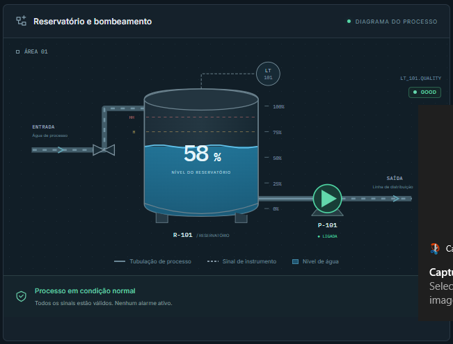
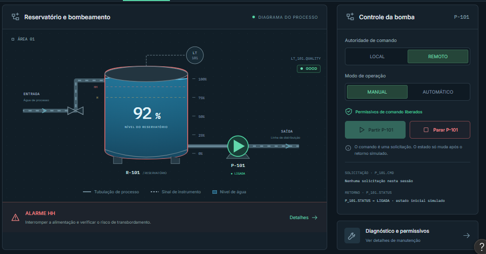
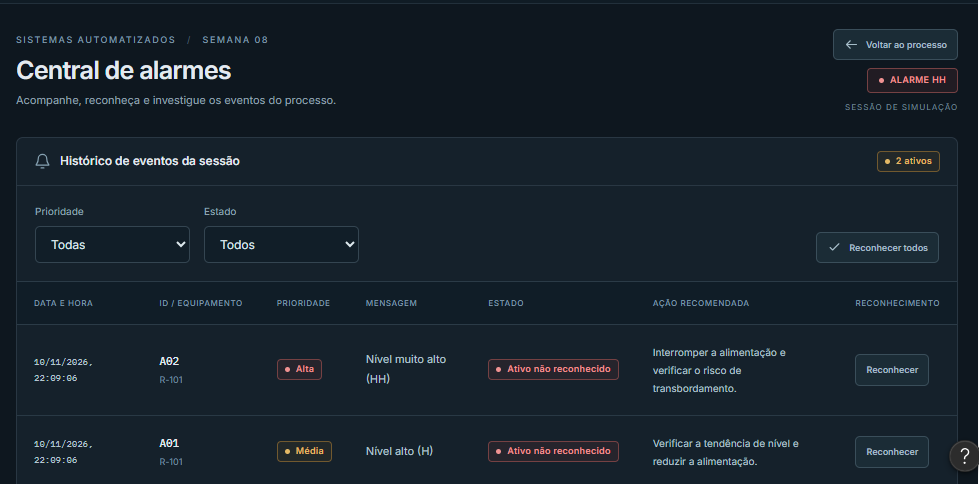
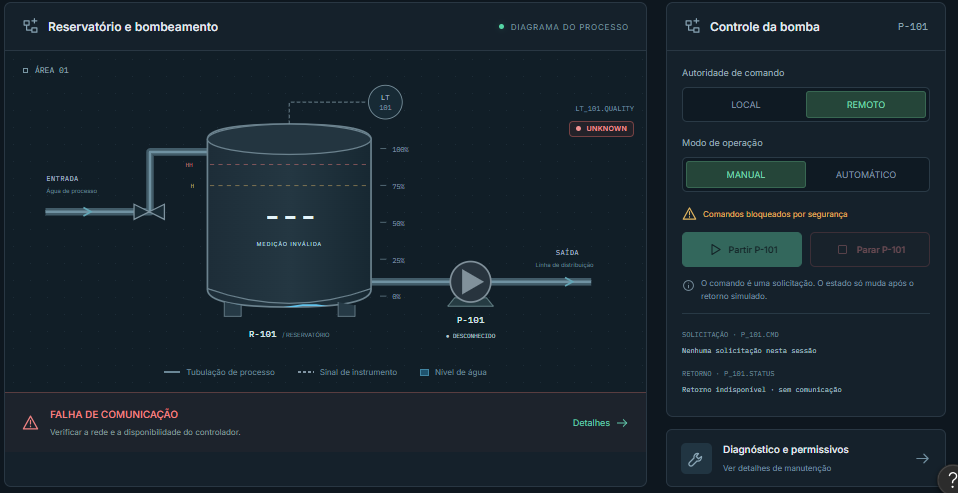
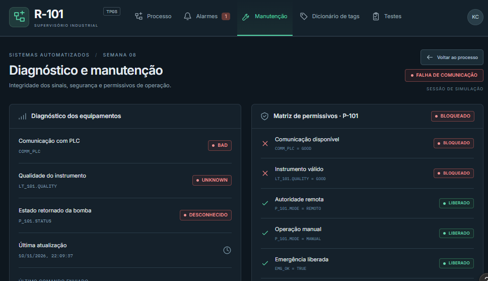

# TP08 - Supervisório Industrial R-101

**Universidade:** São Judas Tadeu (USJT)  
**Curso:** Engenharia de Software  
**Disciplina:** Sistemas Automatizados  
**Professor:** Calvetti  
**Aluno:** Kaic Cavalcanti Pereira  
**Atividade:** TP08 - Sistemas Supervisórios

---

## 📌 Sobre o Projeto

Este projeto foi desenvolvido como parte da atividade prática TP08 da disciplina de Sistemas Automatizados.

O objetivo é desenvolver um protótipo interativo de um sistema supervisório industrial (HMI/SCADA), responsável pelo monitoramento de um reservatório de água R-101 e pelo acompanhamento operacional da bomba P-101.

O sistema permite visualizar níveis, identificar alarmes, acompanhar estados operacionais e consultar informações de manutenção e segurança.

O protótipo foi desenvolvido utilizando o **Figma Make**, com foco em usabilidade, navegação, segurança operacional e representação dos dados do processo.

---

## 🚀 Acesse o Protótipo

### 🔗 [Clique aqui para acessar o Supervisório R-101 no Figma](https://www.figma.com/make/QfRjPm5BUOe8pNhXoM7Bs2/Supervis%C3%B3rio-do-Reservat%C3%B3rio-R-101?t=rMioLqqK0cohwAdt-1)

O protótipo permite navegar entre as telas e simular diferentes condições operacionais do reservatório.

---

## 🖥️ Telas do Sistema

O supervisório apresenta três áreas principais:

- **Processo:** monitoramento do reservatório e controle da bomba.
- **Alarmes:** visualização e reconhecimento de eventos.
- **Manutenção:** diagnóstico de equipamentos e permissivos.

Também estão disponíveis seções de dicionário de tags e testes.

---

## 🟢 1. Processo em Condição Normal



Neste cenário, o reservatório R-101 apresenta nível de **58%**, indicando operação dentro dos limites estabelecidos.

**Condições apresentadas:**

- Nível do reservatório: 58%.
- Qualidade da medição: GOOD.
- Comunicação disponível.
- Bomba P-101 ligada.
- Nenhum alarme ativo.

O operador pode acompanhar visualmente o reservatório, o nível de água e o funcionamento da bomba.

---

## 🔴 2. Processo em Alarme Crítico (HH)



Neste cenário, o reservatório apresenta nível de **92%**, ultrapassando o limite crítico de 90%.

O sistema identifica automaticamente a condição de nível muito alto (HH).

**Condições apresentadas:**

- Nível do reservatório: 92%.
- Qualidade da medição: GOOD.
- Alarme A02 ativo.
- Prioridade alta.
- Destaque visual no reservatório.

**Ação recomendada:** interromper a alimentação e verificar o risco de transbordamento.

---

## 🚨 3. Central de Alarmes



A central de alarmes permite acompanhar os eventos identificados durante a operação.

Cada evento apresenta:

- Data e horário.
- Identificação do alarme.
- Equipamento relacionado.
- Prioridade.
- Mensagem.
- Estado de reconhecimento.
- Ação recomendada.

### Alarmes implementados

| ID | Condição | Prioridade |
|---|---|---|
| A01 | Nível alto (H) - 75% | Média |
| A02 | Nível muito alto (HH) - 90% | Alta |
| A03 | Falha do transmissor | Alta |
| A04 | Falha de comunicação | Alta |

O reconhecimento de um alarme registra que o operador tomou conhecimento da ocorrência, mas não elimina automaticamente a condição que o originou.

---

## ⚠️ 4. Falha de Comunicação



Este cenário demonstra o comportamento do supervisório quando ocorre uma falha de comunicação com o controlador.

**Condições apresentadas:**

- COMM_PLC = BAD.
- Qualidade da medição: UNKNOWN.
- Nível apresentado como "---".
- Estado da bomba desconhecido.
- Comandos operacionais bloqueados.
- Alarme de comunicação ativo.

O bloqueio impede que o operador execute comandos utilizando informações inválidas ou desatualizadas.

Essa funcionalidade representa um princípio importante de segurança em sistemas automatizados.

---

## 🔧 5. Diagnóstico e Manutenção



A tela de manutenção apresenta informações relacionadas à integridade dos equipamentos e às condições necessárias para a operação.

São apresentados:

- Estado de comunicação com o CLP.
- Qualidade do transmissor.
- Estado retornado pela bomba.
- Última atualização.
- Modo de operação.
- Autoridade de comando.
- Matriz de permissivos.

### Permissivos de operação

| Condição | Critério |
|---|---|
| Comunicação | COMM_PLC = GOOD |
| Instrumento | LT_101.QUALITY = GOOD |
| Autoridade | REMOTO |
| Modo operacional | MANUAL |
| Emergência | EMG_OK = TRUE |
| Falha da bomba | P101_FAIL = FALSE |

Caso uma condição obrigatória não seja atendida, a solicitação de comando deve ser bloqueada.

---

## 🏷️ Dicionário de Tags

As tags representam as variáveis utilizadas para monitorar e supervisionar o processo.

| Tag | Tipo | Unidade | Acesso | Descrição |
|---|---|---|---|---|
| LT_101.PV | REAL | % | R | Nível do reservatório |
| LT_101.QUALITY | ENUM | - | R | Qualidade da medição |
| P_101.CMD | BOOL | - | RW | Comando da bomba |
| P_101.STATUS | ENUM | - | R | Estado retornado da bomba |
| P_101.MODE | ENUM | - | R | Modo de operação |
| COMM_PLC | ENUM | - | R | Comunicação com o CLP |

**Legenda:**

- R: somente leitura.
- RW: leitura e escrita.
- REAL: valor numérico.
- BOOL: valor lógico.
- ENUM: conjunto de estados definidos.

O dicionário também está disponível no arquivo `testes/tags.csv`.

---

## 🧪 Cenários de Teste

O protótipo permite simular diferentes situações operacionais para verificar o comportamento da interface.

| Teste | Cenário | Resultado esperado |
|---|---|---|
| T01 | Nível 58%, GOOD | Operação normal |
| T02 | Nível 78% | Alarme H visível |
| T03 | Nível 92% | Alarme HH destacado |
| T04 | COMM_PLC = BAD | Comandos bloqueados |
| T05 | Solicitar parada P-101 | Confirmação específica |

As capturas incluídas neste repositório demonstram visualmente os cenários T01, T03 e T04.

Os resultados de execução dos testes devem ser registrados no arquivo `testes/casos_teste.csv`.

---

## 🔐 Segurança Operacional

O protótipo contempla mecanismos demonstrativos de segurança:

1. Bloqueio de comandos quando a comunicação é inválida.
2. Identificação da qualidade das medições.
3. Diferenciação entre solicitação e retorno de comando.
4. Confirmação antes de comandos que possam impactar o processo.
5. Verificação dos permissivos de operação.
6. Diferenciação visual e textual dos estados operacionais.

Esses recursos buscam reduzir erros de interpretação e melhorar a segurança da interação entre operador e processo.

---

## 🛠️ Tecnologias Utilizadas

- **Figma Make:** desenvolvimento do protótipo interativo.
- **HTML/CSS/JavaScript:** versão complementar de demonstração.
- **CSV:** documentação de tags e casos de teste.
- **Markdown:** documentação do projeto.
- **GitHub:** versionamento e disponibilização da atividade.

---

## 📂 Estrutura do Projeto

```text
semana-08/
│
├── README.md
│
├── evidencias/
│   ├── processo-normal.png
│   ├── processo-hh.png
│   ├── alarmes-hh.png
│   ├── falha-comunicacao.png
│   └── manutencao.png
│
└── testes/
    ├── tags.csv
    └── casos_teste.csv
```

---

## 📋 Limitações do Protótipo

O supervisório foi desenvolvido exclusivamente para fins acadêmicos.

Não existe comunicação real com CLP, sensores, bombas ou equipamentos industriais.

Os valores, estados e comandos são simulados para demonstrar a interface e seu comportamento.

O protótipo não realiza operações físicas nem substitui um sistema SCADA industrial.

---

## ✅ Conclusão

O desenvolvimento do Supervisório R-101 permitiu aplicar conceitos de sistemas automatizados, interfaces homem-máquina, monitoramento de processos, alarmes e segurança operacional.

A atividade demonstra como informações provenientes de um processo industrial podem ser organizadas e apresentadas de maneira clara para apoiar a operação e o diagnóstico.

A implementação também reforça a importância de validar a qualidade dos dados, verificar permissivos e diferenciar solicitações de comando dos estados efetivamente retornados pelo processo.

---

**Desenvolvido por Kaic Cavalcanti Pereira**  
Engenharia de Software - Universidade São Judas Tadeu  
Sistemas Automatizados - TP08
